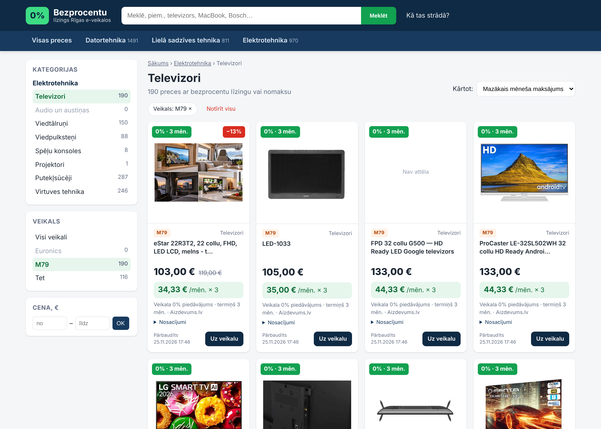

# Bezprocentu: 0% līzings Rīgas e-veikalos

Tīmekļa lapa e-veikala izskatā. Tā katru dienu automātiski apkopo preces no Rīgas interneta veikaliem, kurām pieejams **bezprocentu līzings vai nomaksa** (aizņēmuma likme 0%). Uzsvars ir uz **datortehniku**, **lielo sadzīves tehniku** un **elektrotehniku**. Lapu var lietot bez autentifikācijas, un preces var filtrēt pēc grupas, kategorijas, veikala un cenas, kā arī meklēt un kārtot.



## Arhitektūra

```
            ┌────────────┐   HTTPS (lokāli: Caddy, tls internal)
 pārlūks ──▶│  proxy     │──▶ web (Next.js, SSR) ──▶ api (.NET 10 REST, tikai lasīšana) ──▶ PostgreSQL 18
            └────────────┘                                                                   ▲
                                         collector (.NET 10 worker, ik 12 h) ─ HTTPS ─▶ veikali │
                                                      └──────────────────────────── raksta ─────┘
```

| Komponente | Mape | Apraksts |
| --- | --- | --- |
| `BezProcentu.Core` | `backend/src` | Kategoriju katalogs, veikalu konfigurācija un HTML parseri (AngleSharp). |
| `BezProcentu.Data` | `backend/src` | EF Core + Npgsql, versētas migrācijas, vaicājumi un saglabāšana. |
| `BezProcentu.Collector` | `backend/src` | Ikdienas datu vākšana: ievēro robots.txt, ietur pauzi starp pieprasījumiem, identificējas ar savu User-Agent un apstājas, ja veikals rāda robotu aizsardzību. |
| `BezProcentu.Api` | `backend/src` | Publisks, tikai lasāms REST API ar OpenAPI 3.1 ([docs/openapi.json](docs/openapi.json)). |
| `frontend` | `frontend` | Next.js 16 / React 19. Lapas tiek renderētas serverī, pārlūks API tieši neizsauc. |

### Kā tiek noteikts, ka precei ir 0% līzings

| Veikals | Avots | Piedāvājuma veids |
| --- | --- | --- |
| **M79** | `/pages/bezprocentu-kredits`: "Bez % kredīts 3 mēnešiem ar aizdevuma likmi 0%", summa 100–20 000 € | Veikala piedāvājums: visām precēm cenu robežās |
| **Tet** | `/veikals/nomaksa`: "Bezprocentu nomaksa uz 3, 6 un 12 mēnešu termiņu", pirkumi 70–10 000 € | Veikala piedāvājums. Akcijas preces ar `0%` (`data-split-payment-prices`) tiek atzīmētas kā atsevišķas preces piedāvājums. |
| **Euronics** | Līzinga kalkulators katras preces lapā ("Aizņēmuma likme X %") | Atsevišķas preces piedāvājums: tikai tad, ja X = 0 |

Mēneša maksājums tiek aprēķināts kā cena, dalīta ar garāko 0% termiņu. Iespējamās līguma un komisijas maksas tajā nav iekļautas, un tas ir norādīts pie katras preces.

### Atjaunošana un beigušies piedāvājumi

- Katru veikalu pārbauda ik pēc 12 h (`Collector:RefreshInterval`). Konfigurācija neļauj iestatīt intervālu, kas garāks par 24 h.
- Ja pilnā vākšanā prece vairs nav atrasta, tās piedāvājums uzreiz tiek atzīmēts kā neaktīvs.
- Ja veikala lapā vairs nav 0% piedāvājuma, visas šī veikala preces tiek paslēptas.
- API rāda tikai piedāvājumus, kas pārbaudīti pēdējo **36 h** laikā (`Offers:MaxAge`). Ja vākšana kļūdas dēļ neizdodas, novecojuši dati tik un tā pazūd.
- Katra vākšanas reize tiek ierakstīta tabulā `collection_runs`, un kļūdas ir redzamas lapā **/par** un kājenē.

## Lokāla palaišana (Docker Compose)

Nepieciešams Docker ar Compose v2.

```bash
cp .env.example .env
```

Failā `.env` ieraksti savas lokālās paroles (tikai izstrādei; fails ir `.gitignore`).

```bash
docker compose up -d --build
```

Lapa: **https://localhost:8443**. Caddy izmanto savu lokālo CA, tāpēc pārlūks pirmajā reizē brīdinās par sertifikātu.

Pirmā datu vākšana sākas uzreiz pēc startēšanas un ilgst apmēram 10–50 minūtes (Euronics pārbauda līdz 1500 preču lapām ar 1,5 s pauzi). Žurnāli: `docker compose logs -f collector`.

Vākšanu vienreiz var palaist arī manuāli:

```bash
docker compose run --rm collector --once
```

### Ja būvēšana notiek aiz TLS pārtveroša starpniekservera

Dockerfile failos ir neobligāts BuildKit noslēpums `extra_ca`. To izmanto tikai `restore` un `npm ci` solī, un gala attēlā tas netiek saglabāts:

```bash
docker build --secret id=extra_ca,src=/path/to/ca.crt --target api -t bezprocentu-api:local backend
```

## Izstrāde bez Docker

Prasības: .NET SDK 10.0.404 (`backend/global.json`), Node.js 22 un PostgreSQL 18.

```bash
cd backend && dotnet test
```

Integrācijas testi paši palaiž PostgreSQL 18 ar Testcontainers, tāpēc vajadzīgs Docker.

```bash
cd frontend && npm ci && npm run lint && npm run typecheck && npm test && npm run build
```

Konfigurācija tiek nodota ar vides mainīgajiem, un repozitorijā nav īstu paroļu:

| Mainīgais | Kur | Nozīme |
| --- | --- | --- |
| `ConnectionStrings__Default` | api, collector | PostgreSQL savienojums. Ja nav norādīts, serviss nestartē. |
| `Collector__RefreshInterval` | collector | Cik bieži atjaunot katru veikalu (≤ 24 h) |
| `Collector__MaxPagesPerListing` | collector | Lapu limits katrai kategorijai (noklusējums 10) |
| `Collector__MaxProductPagesPerRun` | collector | Euronics preču lapu limits vienā vākšanā (1500) |
| `Collector__RequestDelay` | collector | Minimālā pauze starp pieprasījumiem (≥ 0,5 s) |
| `Offers__MaxAge` | api | Pēc cik ilga laika nepārbaudīts piedāvājums tiek paslēpts (36 h) |
| `API_BASE_URL` | web | Iekšējā API adrese. Ja nav norādīta, lapa nestartē. |

## Drošība

- **Publiska piekļuve bez autentifikācijas** atbilst specifikācijai. API nodrošina tikai `GET` galapunktus ar publiskiem veikalu datiem un vākšanas statusu, un tas ir dokumentēts OpenAPI aprakstā. API nav publicēts uz hosta: tas atrodas iekšējā `backend` tīklā bez interneta piekļuves.
- **Mazākās privilēģijas DB lomas** (`db/init/01-roles.sh`):
  - `bp_owner` izmanto tikai migrācijām;
  - `bp_collector` drīkst SELECT, INSERT un UPDATE, bet ne DELETE vai DDL;
  - `bp_api` drīkst tikai SELECT.
- **Ievaddatu validācija** notiek servera pusē: filtri tiek salīdzināti ar atļauto vērtību sarakstiem, ir garuma un diapazona ierobežojumi, SQL vaicājumi ir parametrizēti, un `ILIKE` meklēšanā aizstājējzīmes tiek ekranētas.
- **Dati no veikaliem** tiek pieņemti tikai tad, ja saites ir https un ved uz zināmiem veikala hostiem. `javascript:` un svešu domēnu saites tiek atmestas, un frontend to pārbauda vēlreiz.
- **Kļūdas** tiek atgrieztas kā ProblemDetails ar `correlationId`, bez steka izsekojuma.
- **Drošības galvenes:** CSP ar nonce (`proxy.ts`), `img-src` atļauts tikai veikalu CDN, `frame-ancestors 'none'`, `nosniff`, HSTS. API ir arī pieprasījumu skaita ierobežojums.
- **Kolektors** nekad neapiet robotu aizsardzību. Atbildes 403 un 429 vai Cloudflare izaicinājuma lapa aptur vākšanu konkrētajam veikalam, un to fiksē `collection_runs`.
- **Žurnāli** ir strukturēti JSON formātā ar UTC laiku, `correlationId` un `runId`. Pieprasījumu saturs netiek žurnalēts.

## Kas pārbaudīts (šajā izstrādes vidē)

| Pārbaude | Rezultāts |
| --- | --- |
| `dotnet build` (TreatWarningsAsErrors) | ✅ |
| `dotnet test`: 78 testi (parseri, robots.txt, robotu aizsardzība, validācija, DB ar PostgreSQL 18, API) | ✅ 78/78 |
| `npm run lint`, `typecheck`, `test` (16), `build` | ✅ |
| `dotnet list package --vulnerable --include-transitive`, `npm audit` | ✅ 0 ievainojamību |
| Docker attēlu būvēšana (api, collector, web), ne-root lietotāji | ✅ |
| `docker compose`: db, migrate, collector, api, web | ✅ |
| Vākšana no īstajiem veikaliem konteinerī | ✅ M79 ~3300, Tet ~2000 preces. Euronics: ~100 pārbaudītās preces bez 0% |
| DB lomu tiesības (api nevar rakstīt, collector nevar dzēst vai mainīt shēmu) | ✅ |
| Lapa pārlūkā caur HTTPS (desktop un mobilais), filtri, meklēšana, kārtošana | ✅ |

**Nav pārbaudīts:**
- `proxy` (Caddy) serviss nav palaists, jo Docker Hub šajā vidē atteica attēla lejupielādi (429). HTTPS tika pārbaudīts ar pagaidu TLS termināciju.
- GitHub Actions darbplūsmas (`.github/workflows`) ir melnraksts un vēl nav palaistas.
- Slepeno vērtību skeneris (piem., gitleaks) un konteineru attēlu ievainojamību skeneris lokāli nav palaisti.

## Ierobežojumi un nākamie soļi

- **Nepieejamie veikali.** 1a.lv, RD Electronics, Dateks, Ksenukai, 220.lv un Balticdata automatizētiem pieprasījumiem atbild ar robotu aizsardzību (Cloudflare). Tie tiek rādīti kā "nav pieejams". Lai tos pievienotu, vajadzīga oficiāla preču plūsma vai API vai veikala atļauja.
- **Euronics.** Pārbaudes brīdī 0% piedāvājumu nebija (likme 20%). Kolektors tos parādīs, kad veikals sāks akciju. Euronics 0% akcijas lapas formāts vēl nav redzēts, tāpēc parseris var būt jāpielāgo.
- **M79 dati.**
  - Nosaukumi sarakstā ir saīsināti ("…").
  - Dažās kategorijās veikalā ir sajauktas preces. Svešu kategoriju preces tiek atfiltrētas, bet kategorijā "Laptopi" veikals ievieto arī rezerves daļas.
- **Lapu struktūras izmaiņas.** Ja veikals maina HTML, parseris atgriezīs mazāk preču. Vākšanas statuss ir redzams lapā `/par`; ieteicams pievienot brīdinājumu, ja preču skaits strauji krītas.
- **Juridiski.** Pirms publiskas izvietošanas pārbaudi veikalu lietošanas noteikumus par datu apkopošanu un attēlu rādīšanu (attēli tiek rādīti no veikalu CDN, tie netiek kopēti).
- **Izvietošana.** Tā netika veikta. Produkcijā vajadzīgs uzticams TLS sertifikāts, slepeno vērtību pārvaldība (nevis `.env`), DB rezerves kopijas un monitorings, kas pamana neveiksmīgas vākšanas.
